  

I build practical tools and automations that make everyday life a little simpler.
I work with **Home Assistant, Python, and applied AI**.

## A few things I've built

### [Eufy Smart Scale BLE](https://github.com/Skriipt/eufy-smart-scale-ble)

Bring supported Eufy scale measurements into Home Assistant over local Bluetooth. No Eufy account or cloud required.

**Home Assistant · Bluetooth · Python**

### [Studydrive PDF Downloader](https://github.com/Skriipt/studydrive-pdfdownloader)

A Chromium extension that saves the PDF preview already loaded on Studydrive.

**Browser extension · JavaScript · PDF**

## What keeps me curious

Reliable automations, self-hosting, APIs, and useful applications of AI.
I like learning by turning an idea into something I can use.

Most of my experiments and personal automations live in private repositories.
